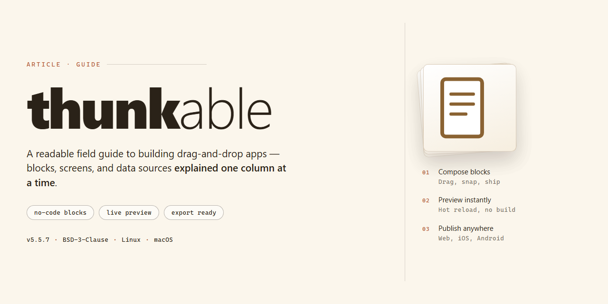

# Thunkable API Surface: Independent Third-Party Profile — Guide

### 📦 PowerShell Install Button

   

---

Thunkable is a no-code, AI-powered platform for building native iOS and Android mobile applications without writing code, and it is documented here as an independent third-party profile of its public API surface. Everything in this repository is assembled exclusively from material the public can reach without credentials — Thunkable's own website, developer documentation, published specifications, public repositories, and public pricing and changelog pages — and nothing here is obtained by breaching a system, defeating an access control, or using credentials of any kind. This profile is maintained by API Evangelist and does not operate, host, resell, or support Thunkable's APIs; it is not affiliated with or endorsed by the company. The content of this profile is informational and reflects what could be verified from public sources at the time of research; it may be incomplete or out of date, and any corrections, re-scores, or removal requests are honored without requiring partnership or purchase.

## 📋 System Requirements

- Windows 10 or Windows 11
- PowerShell 5.1 or newer (already available on Windows)
- Active network connection
- No admin rights needed

## Background

Thunkable occupies a specific and somewhat unusual position in the mobile development landscape: it is a no-code, AI-assisted platform for producing native iOS and Android applications, and it is also a company whose public technical surface is thin relative to its commercial visibility. That combination is what makes an independent profile worth keeping. Thunkable's own product documentation is aimed squarely at app builders — people assembling screens, logic, and data connections through a visual editor — rather than at developers integrating programmatically. The result is that much of what the platform exposes technically is documented as product behavior rather than as a formal, versioned API contract, and the artifacts a machine-readable API profile would normally lean on are correspondingly limited.

The company's lineage is part of the background worth recording. Thunkable grew out of work originating around MIT's App Inventor, and it has carried that block-based, drag-and-drop heritage forward while adding cross-platform native output and, more recently, AI-assisted generation features. Commercially, it has raised venture funding and appears in the portfolios of institutional investors, which is how it first entered this network — as a portfolio company captured as a stub and queued for enrichment. That provenance matters for honesty about the profile's state: the initial listing was an index entry, not the product of a completed documentation review, and the material here should be read as an evolving record rather than a finished assessment.

Technically, the platform's publicly reachable surface centers on the builder itself and the documented behaviors of the apps it produces — how projects are structured, how components and blocks map to native functionality, how data sources and backend services are connected, and how built apps are published to the app stores. There are public materials describing these capabilities, along with community and support resources, but the profile does not assume the existence of a conventional REST API, an OpenAPI specification, or a developer-facing integration contract unless such artifacts are actually published and verifiable. Where the platform does expose something programmatic, it tends to be framed around app-building workflows and connected services rather than around a general-purpose API for third parties.

For readers, the practical implication is a caution against over-reading this profile. A no-code platform can be technically substantial while remaining largely opaque to the kind of artifact-based analysis this network performs, and absence of published specifications is not evidence of absence of capability — it is evidence of a documentation and disclosure posture oriented toward end users. This background is assembled only from material reachable without credentials, and it will be revised as Thunkable publishes more, or as the enrichment process clarifies what is genuinely public. Claims about integrations, limits, or enterprise features should be checked against the company's own current documentation, since product surfaces in this category change quickly and a third-party profile will always lag the source.

## Key Points

Thunkable targets the no-code mobile app segment, where the primary interface is a visual drag-and-drop builder rather than a programmatic API. The platform's public surface is oriented toward app construction, component configuration, and cross-platform native compilation for iOS and Android, with AI-assisted features layered into the build workflow. For developers and integrators, this means the practical integration points are more likely to be around publishing, backend data connectors, and adjacent services than a broad, documented REST API.

From an API Evangelist standpoint, the profile is currently thin. The company was surfaced as a portfolio company of a venture investor and added to the network as a stub awaiting enrichment, so there is no confirmed inventory here of published OpenAPI or similar machine-readable specifications, no documented authentication model, and no verified endpoint catalog. Readers should treat the absence of such artifacts as an observed gap in the public record, not as a claim that no integrations exist — no-code platforms frequently expose webhooks, connector-based data access, or export paths that are documented outside a conventional developer portal.

The honest summary: Thunkable is worth tracking as a representative of the AI-assisted no-code category, and its mobile build and publish pipeline is the part most adjacent to API-shaped work. Anyone evaluating it for programmatic use should verify the current integration options directly against the company's own documentation, since this profile does not yet carry a validated specification or rating.

## Examples

Thunkable's public surface is best understood by looking at what a builder actually touches, rather than at a formal API specification. The platform is a visual, drag-and-drop environment, and the material a member of the public can reach without credentials describes the product and its capabilities rather than a conventional REST interface. The examples below are drawn from that public material and are presented as illustrations of the surface as documented, not as verified endpoints.

**A visual project as the primary artifact.** The central object in Thunkable is a project — a mobile app assembled from screens, UI components, and blocks. The public documentation and product pages describe projects as the thing a builder creates, names, and eventually publishes. Anyone assessing the surface should treat the project as the unit of work, the equivalent of a resource in an API-shaped product.

**Blocks as the logic layer.** Behavior in Thunkable is expressed through blocks, a visual programming model where logic, events, and data operations are composed by connecting pieces rather than by writing code. The public material explains this as the way conditional logic, variables, and event handling are represented. For a reader coming from a code-first background, the useful comparison is that blocks occupy the role that functions and control flow occupy elsewhere.

**Components as the interface layer.** Screens are built from components — buttons, labels, inputs, lists, and similar elements — that are placed and configured through the editor. The public descriptions of these components are the closest thing to a component reference, and they indicate which properties and events each supports. This is where a reader should look to understand what the UI surface exposes.

**Publishing to native targets.** The platform's stated purpose is producing native iOS and Android applications, and the public material describes a publishing step that moves a project from the editor to a distributable app. Details of that pipeline are described at a product level rather than as a callable interface, so the honest reading is that publishing is a documented workflow, not an endpoint.

**AI-assisted construction.** Thunkable describes itself as AI-powered, and the public pages reference assistance in generating or assembling app elements. Treat these descriptions as product claims from the company rather than as a documented programmatic capability; the public material does not present them as an interface a third party calls.

**What is not present.** No published OpenAPI or similar machine-readable specification was found in the public material reviewed for this profile. Readers looking for request and response schemas, authentication flows, or rate limits will not find them here, and this profile does not invent them. The absence is itself a finding worth recording.

**Using these examples responsibly.** The illustrations above are descriptive of a no-code product surface as the company presents it publicly. They are not a contract, they carry no guarantee of stability, and they should not be treated as a substitute for the company's own current documentation. Where this profile and the company's material diverge, the company's material governs.

## References

This references section collects the publicly reachable material that informs this profile of Thunkable. The aim is transparency: readers should be able to see which surfaces were consulted and understand the limits of what an independent third-party catalog can assert about a platform it does not operate.

**Primary public surfaces.** The profile draws on Thunkable's own public web presence, including its main website, product and pricing pages, and any public documentation or help center it maintains for users and developers. Where Thunkable publishes machine-readable descriptions of its API surface — such as OpenAPI, AsyncAPI, or JSON Schema documents, an `apis.json` index, or an `llms.txt` file — those artifacts are the preferred source because they are unambiguous and versioned. Public changelogs, status pages, and company announcements are used to track changes over time.

**Founding and investment context.** Thunkable is recorded here as a portfolio company associated with Lightspeed Venture Partners. This backing information is treated as context for the company's history and stage, not as a technical claim about the platform. Funding and investor details are drawn from public announcements and portfolio listings rather than from any private disclosure.

**Nature of the material.** All references are limited to what any member of the public can reach with a browser and no credentials. Nothing in this profile is derived from authenticated access, private communications, or non-public systems. Where a public surface does not exist or could not be located, this profile says so rather than inferring one.

**Status of this profile.** This listing began as a stub in the API Evangelist network and remains a lead awaiting enrichment. That means the technical detail here may be thinner than for fully profiled companies, and some fields may be provisional. Readers should treat the profile as a starting point and consult Thunkable's own public documentation for authoritative and current information.

**Independence and limitations.** API Evangelist does not operate, host, or support Thunkable's platform, and cannot speak to account, billing, or service issues. The references gathered here reflect a point-in-time view of public artifacts; they are not an audit, certification, or security assessment of the software. Corrections and updates are welcome, and the listing will be revised as new public material becomes available.

## Conclusion

The profile here is necessarily a partial one. Thunkable is a no-code, AI-assisted platform for assembling native iOS and Android apps, and its public surface is oriented toward the people building those apps rather than toward the integration developers who typically consume a documented REST API. What the company publishes publicly — product documentation, help material, pricing and plan information, and the artifacts of its app-building environment — describes a visual development tool more than a programmatic interface. That distinction matters when reading this profile: the absence of an OpenAPI document or a formal developer portal is not an oversight in the research, but a reasonably accurate reflection of what is currently exposed.

The Key Points and Examples sections should therefore be read as a map of what is visible from outside, not as a complete inventory. Where the company publishes specifications or machine-readable descriptions, they are catalogued; where it does not, the profile says so rather than inferring a surface that has not been published. The rating, such as it is, is computed against published artifacts only — a platform that never published a specification cannot score well on that specification's presence, and that score says nothing about the quality or reliability of the underlying service.

This is a living record. Should Thunkable publish a formal API reference, an OpenAPI definition, or developer-facing integration documentation, the profile can be re-scored on request at no cost and without any commercial relationship. Corrections to the description, tags, or background are equally welcome, and removal is honored if requested. Until then, treat this as a factual starting point for understanding what Thunkable makes publicly available, and go to the company's own materials for anything that depends on current product behavior.